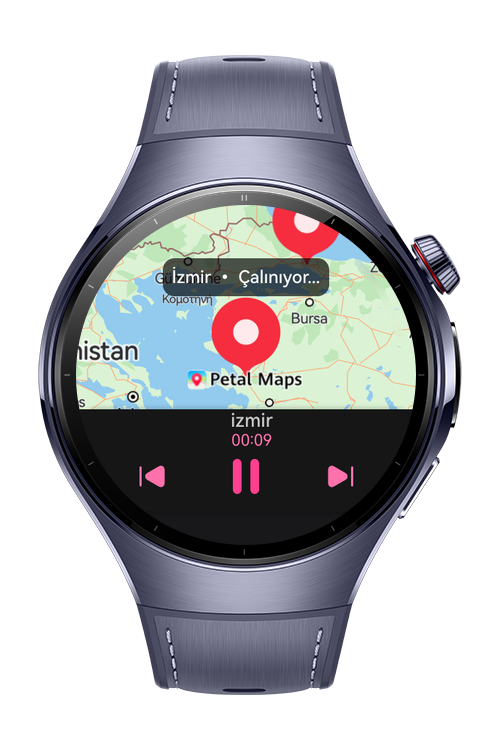
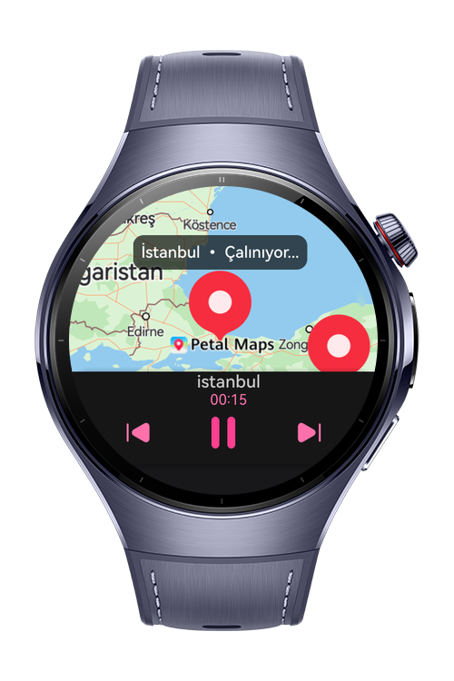
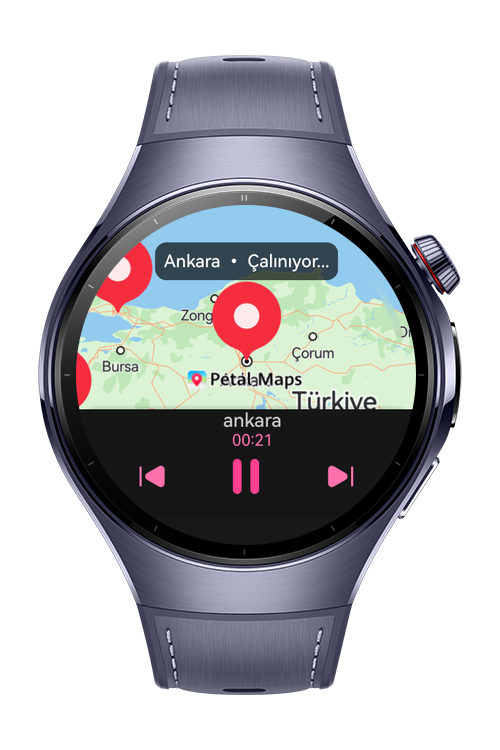
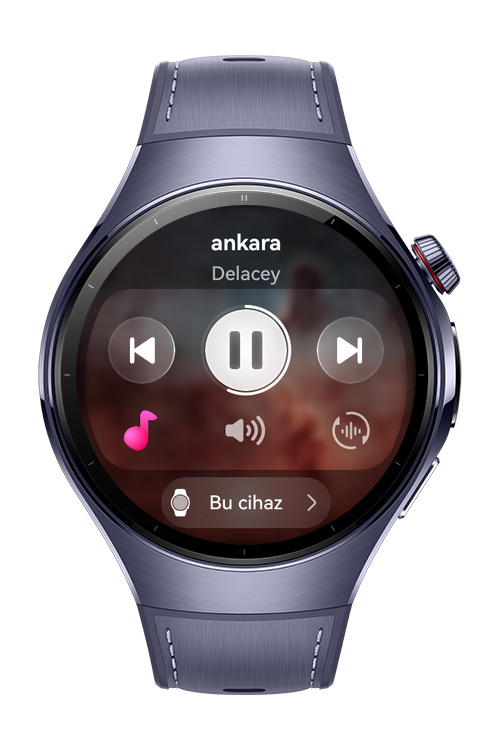

> **Note:** To access all shared projects, get information about environment setup, and view other guides, please visit [Explore-In-HMOS-Wearable Index](https://github.com/Explore-In-HMOS-Wearable/hmos-index).

# Sound Map

Sound Map is a wearable map-driven music player built with ArkTS and ArkUI for HarmonyOS smartwatches. The main screen shows a Turkey map; when the user taps a city marker, the app plays a local (offline) MP3 mapped to that city’s plate code. It supports background playback, crown control, lock-screen controls, and a compact mini-player under the map.

-----

# Preview

<p align="left">
  
  
  
  
</p>

# Use Cases
- Map-Based Playback (TR Plate Code): Tap a city marker (e.g., İstanbul/34, Ankara/6, İzmir/35). The app resolves the plate code and plays the corresponding local MP3; if no mapping exists, it falls back to a default track.

- Real-Time Music Playback: Smooth play/pause/seek with a resilient AV pipeline; keeps playing while you navigate the map.

- Crown Button Control: Skip tracks and toggle play/pause with the watch crown; volume can also be adjusted via crown in the custom dialog.

- Mini-Player for Round Displays: A compact player under the map with Prev / Play-Pause / Next, current time, and progress—optimized for circular screens.

- Custom Volume Dialog: A quick, watch-friendly dialog to adjust device media volume in real time.

- Background & Resume: Music continues in the background; returning to the app restores progress and state seamlessly.

- Lock Screen Control (AVSession): Control playback from the system lock screen (play/pause, next/previous).

------
# Tech Stack

- Languages: ArkTS (Ark TypeScript)

- Frameworks: HarmonyOS SDK 5.1.0 (API Version 18)

- Tools: DevEco Studio Version 5.1.0.842

- Libraries & Kits:
    - `@kit.MapKit` - Map view, markers, and custom info window integration.
  
    - `@kit.MediaKit` – AVPlayer for audio playback (play, pause, next/previous, seek).
  
    - `@kit.AVSessionKit` – AV session metadata & lock-screen controls.

   - `@kit.AudioKit` – Stream usage, output device handling, and volume group management.

   - `@kit.BackgroundTasksKit` – Keeps audio running when the app goes to background
  
   - `@kit.AbilityKit` – WantAgent for background/launch intents.
  
   - `@kit.LocalizationKit` – Resource manager for media/artwork (rawfile and images).

   - `@kit.PerformanceAnalysisKit` – hilog for structured logging

   - `Crown Event methods` – Hardware crown interaction for playback and volume.

 ---
# Directory Structure

```
|---audio
|   |---AVSessionController.ets   
|   |---BackgroundUtil.ets        
|   |---CustomAudioManager.ets    
|   |---MediaController.ets       
|   |---MediaTools.ets            

|---common
|   |---constants
|   |   |---MusicData.ets           
|   |   |---CityMusicLocal.ets        

|   |---model
|   |   |---MusicModel.ets            # Data model for a single music track

|---pages
|   |---Index.ets                 # App entry point and routing logic
|   |---MapMusicPage.ets          # Main UI for playback and interaction

|---viewmodel
|   |---MainViewModel.ets         # Manages playback state and view-related logic
```

---

# Constraints and Restrictions

## Supported Devices

- Huawei Watch 5
- Devices running HarmonyOS 5.1.0 (API 18) and above

---

# LICENSE

SoundMap is distributed under the terms of the MIT License
See the [LICENSE](./LICENSE) for more information.